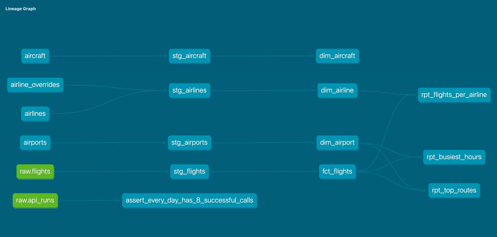
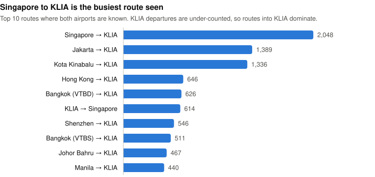
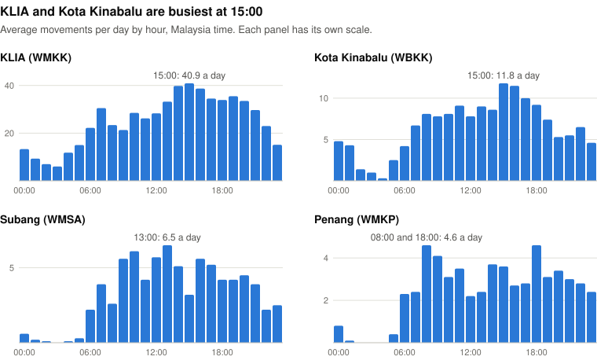
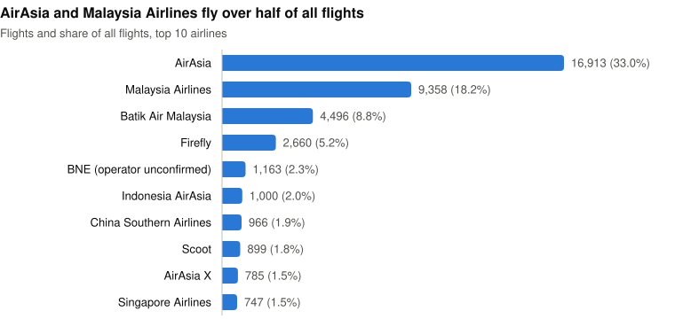

[](https://github.com/siti-zu/malaysia-flights-pipeline/actions/workflows/ci.yml)

# malaysia-flights-pipeline

A daily data pipeline that tracks flights at four Malaysian airports. Python pulls arrivals and departures from the [OpenSky Network](https://opensky-network.org/) API into PostgreSQL, dbt turns the raw JSON into a tested star schema, and three reporting marts answer one question each: which routes are busiest, when are the airports busiest, and which airlines fly most?

The airports are Kuala Lumpur International (KLIA, `WMKK`), Sultan Abdul Aziz Shah in Subang (`WMSA`), Penang International (`WMKP`) and Kota Kinabalu International (`WBKK`).

**Current data:** 51,310 flights by 2,596 aircraft, from 59 days of API data (2026-09-05 to 2026-11-02 UTC). A scheduled job adds each new day.

## How it fits together

```
OpenSky REST API  ──►  Python ingestion  ──►  PostgreSQL: raw schema  ──►  dbt  ──►  analytics schema
  /flights/arrival       (ingestion/)          raw.flights                          staging → fct + dims → rpt_*
  /flights/departure                           raw.api_runs
```



Green nodes are the raw sources. Reading left to right: seeds and sources, staging views, the fact and dimension tables, then the reporting marts. `raw.api_runs` feeds only the completeness test, since it records API calls, not flights. Run `make docs` to explore the graph.

**Built with:** Python 3.13 and [uv](https://docs.astral.sh/uv/), `requests` with `urllib3` retries, `psycopg` 3, PostgreSQL 16 in Docker, dbt Core with [dbt_utils](https://hub.getdbt.com/dbt-labs/dbt_utils/latest/), GitHub Actions and launchd.

## Quick start

You need [Docker Desktop](https://www.docker.com/products/docker-desktop/), [uv](https://docs.astral.sh/uv/getting-started/installation/), `make`, and a free [OpenSky Network](https://opensky-network.org/) account with an API client (this gives you a client ID and secret).

```bash
git clone https://github.com/siti-zu/malaysia-flights-pipeline.git
cd malaysia-flights-pipeline
cp .env.example .env     # then fill it in, see below
make install             # create the Python environment
make up                  # start Postgres; first start creates the raw tables
make ingest              # load yesterday (UTC)
make transform           # load the seeds, build every dbt model and run every test
```

In `.env`, the database values both create the Postgres container and connect to it, so you can choose any user, password and database name:

```bash
DB_HOST=localhost
# Any free port; 5433 avoids clashing with a local Postgres on 5432
DB_PORT=5433
DB_NAME=flights
DB_USER=flights
DB_PASSWORD=change-me

CLIENT_ID=your-opensky-client-id
CLIENT_SECRET=your-opensky-client-secret
```

| Command | What it does |
| --- | --- |
| `make ingest DATE=2026-09-15` | Load one day. Dates must be yesterday or earlier, because OpenSky processes each day in a nightly batch. |
| `make backfill START=2026-09-01 END=2026-09-07` | Load a range. `END` defaults to yesterday. |
| `make seeds` | Rebuild the seed CSVs from their sources. |
| `make test` | Run the Python tests. |
| `make freshness` | Warn if the daily run has stopped. |
| `make docs` | Generate and serve the dbt docs. |
| `make help` | List every command. |

More detail: [running the pipeline](docs/operations.md) (schedule, credits, CI) and the [data model and seeds](docs/data_model.md).

## Design decisions

### ELT: raw data first, transformations later

Each flight is stored as the untouched JSON object OpenSky returned, in a `JSONB` column, and all cleaning happens later in dbt. **Why:** every API call costs credits. If a transformation turns out to be wrong, it can be fixed and re-run against the raw data without calling the API again.

### Idempotent loads

Data is loaded one airport, direction and day at a time. The loader deletes that slice and inserts the new rows in a single transaction. **Why:** re-running any day, or overlapping a backfill with days already loaded, can never create duplicates or leave a half-loaded slice, so recovering from a failure is just running it again.

### Failure handling

Every API call is logged to `raw.api_runs`, whether it worked or not. What happens next depends on the failure:

| Failure | What happens | Why |
| --- | --- | --- |
| One call fails, such as a `500` | The other calls still run, and the run exits with code 1 | One bad airport shouldn't lose the rest of the day, but a scheduler still needs to know |
| `401` or `429` | The whole run stops at once | Every remaining call would fail the same way, and credits or bad credentials won't fix themselves mid-run |
| The database goes down | The run stops and exits with code 1 | Carrying on would spend credits with no audit trail |
| The API call works but the load fails | Logged with its `200` and an `error_message`, but no `row_count` | The log has to show what was actually written, so the completeness check can catch it |

<!-- Screenshot: backfill stopping cleanly at the credit limit -->

### Retries

Temporary server errors (`500`, `502`, `503`, `504`) and connection errors are retried up to 3 times with exponential backoff. `429` is deliberately left out. **Why:** a server blip often clears within seconds, but retrying when out of credits can't succeed.

### Run IDs

Every run gets a UUID, written to every row it creates in both `raw.flights` and `raw.api_runs`. **Why:** any row can be traced back to the run that loaded it, and everything that happened in one run is a single `WHERE run_id = ...` query.

### The dedupe rule

A flight between two of the four airports, such as KLIA → Penang, is returned twice: once as a departure from KLIA and once as an arrival at Penang. `fct_flights` keeps one row per **`icao24` + `first_seen`**, across all dates. **Why:** `icao24` alone identifies the aircraft, not the flight, and the two copies can have different query dates, so deduplicating within a single day would miss them. The evidence is under [Data quality](#data-quality).

### Airline overrides

Airline names come from the first 3 letters of the callsign, joined to OpenFlights. [airline_overrides.csv](malaysia_flights_dbt/seeds/airline_overrides.csv) is a small hand-checked seed that fills gaps and corrects out-of-date names, with a `source` column for each of its 17 rows. **Why:** OpenFlights lacks some active airlines and still lists Batik Air Malaysia as Malindo Air, and keeping fixes in their own seed means the downloaded file can be refreshed without losing them. It took unmatched flights from 6.3% to 0.2%.

## Data quality

Figures are from 2026-11-03. The tests described here run on every `make transform`, except freshness, which has its own command.

### Dedupe numbers

<details>
<summary>The query behind the rule</summary>

```sql
WITH dupes AS (
    SELECT
        icao24,
        first_seen,
        COUNT(*) AS copies,
        COUNT(DISTINCT last_seen) AS different_last_seen,
        COUNT(DISTINCT est_arrival_airport) AS different_arrival,
        COUNT(DISTINCT query_date) AS different_query_dates
    FROM analytics.stg_flights
    WHERE first_seen IS NOT NULL
    GROUP BY icao24, first_seen
    HAVING COUNT(*) > 1
)
SELECT
    COUNT(*) AS duplicated_flights,
    MAX(copies) AS max_copies,
    COUNT(*) FILTER (WHERE different_last_seen > 1 OR different_arrival > 1) AS copies_that_disagree,
    COUNT(*) FILTER (WHERE different_query_dates > 1) AS cross_date_duplicates
FROM dupes;
```

</details>

| Duplicated flights | Most copies of one flight | Copies that disagree | Duplicates spanning two dates |
| ---: | ---: | ---: | ---: |
| 3,153 | 2 | 0 | 244 |

- **The copies are identical.** No flight has more than 2 copies and none disagree on `last_seen` or the arrival airport, so it doesn't matter which copy is kept.
- **244 duplicates span two dates**, such as a late-night departure that arrives after midnight UTC. That's why deduplication works across all dates.

| Step | Rows |
| --- | ---: |
| `stg_flights` | 54,467 |
| Null `first_seen` removed | −4 |
| Duplicate copies removed | −3,153 |
| **`fct_flights`** | **51,310** |

### Match rates

Each join from `fct_flights` to a dimension has a `relationships` test set to warn. **Why warn:** some gaps are expected, so they're reported on every build without failing it. Each rate is out of the flights where the value is known.

| Join | Flights with a value | Unmatched | Matched | Why some don't match |
| --- | ---: | ---: | ---: | --- |
| `airline_code` → `dim_airline` | 50,152 | 122 | 99.8% | Private, military and other callsigns whose first 3 letters aren't an airline code |
| `icao24` → `dim_aircraft` | 51,310 | 4,043 | 92.1% | Flown by 223 of the 2,596 aircraft, which aren't in OpenSky's aircraft database |
| `est_departure_airport` → `dim_airport` | 31,650 | 0 | 100% | |
| `est_arrival_airport` → `dim_airport` | 44,379 | 0 | 100% | |

### Freshness and completeness

- **Freshness:** `make freshness` warns if the newest call in `raw.api_runs` is over 26 hours old, which means the daily run has stopped. It's 26 rather than 24 so a slightly late run doesn't trigger it.
- **Completeness:** [a singular test](malaysia_flights_dbt/tests/assert_every_day_has_8_successful_calls.sql) fails for any date without a successful call for all 4 airports × 2 directions, including a day with no calls at all. A call with an `error_message` doesn't count, because the API can return `200` and the load still fail.

Both currently pass, and the completeness test finds no missing days.

### Tests and CI

`make transform` runs 49 dbt data tests, including a test on each reporting mart's grain, so a join that doubles rows fails the build. `make test` runs 51 pytest tests covering date handling, the API client and the run's failure rules, using fakes so they spend no credits. [CI](.github/workflows/ci.yml) runs both on every push and pull request, with `dbt build` against a throwaway Postgres.

## Results

Covers 51,310 flights from 59 days of API data, to 2026-11-02.

> **KLIA departures are under-counted.** The data has 29,080 arrivals at KLIA but only 7,555 departures, while a real airport has roughly equal numbers. Kota Kinabalu (4,802 and 4,681) and Subang (2,379 and 2,432) are balanced. So treat KLIA's figures as patterns in OpenSky's coverage, not exact traffic counts.

### Which routes are busiest?

**Singapore → KLIA, with 2,048 flights.** Nine of the top 10 routes go into KLIA, which mostly reflects the under-count above: the same route in reverse has only 614.

<picture>
  <source media="(prefers-color-scheme: dark)" srcset="docs/images/top_routes_dark.svg">
  
</picture>

<details>
<summary>Table: top 10 routes</summary>

| Rank | Route | From | To | Flights |
| ---: | --- | --- | --- | ---: |
| 1 | `WSSS-WMKK` | Singapore | KLIA | 2,048 |
| 2 | `WIII-WMKK` | Jakarta | KLIA | 1,389 |
| 3 | `WBKK-WMKK` | Kota Kinabalu | KLIA | 1,336 |
| 4 | `VHHH-WMKK` | Hong Kong | KLIA | 646 |
| 5 | `VTBD-WMKK` | Bangkok (Don Mueang) | KLIA | 626 |
| 6 | `WMKK-WSSS` | KLIA | Singapore | 614 |
| 7 | `ZGSZ-WMKK` | Shenzhen | KLIA | 546 |
| 8 | `VTBS-WMKK` | Bangkok (Suvarnabhumi) | KLIA | 511 |
| 9 | `WMKJ-WMKK` | Johor Bahru | KLIA | 467 |
| 10 | `RPLL-WMKK` | Manila | KLIA | 440 |

</details>

### When are the airports busiest?

**Mid-afternoon at KLIA and Kota Kinabalu, both peaking at 15:00.** Subang peaks at 13:00, and Penang has two equal peaks at 08:00 and 18:00. All times are Malaysia time. Departures are counted at `first_seen` and arrivals at `last_seen`.

<picture>
  <source media="(prefers-color-scheme: dark)" srcset="docs/images/busiest_hours_dark.svg">
  
</picture>

<details>
<summary>Table: three busiest hours at each airport</summary>

| Airport | Busiest hours | Average movements per day in the busiest hour |
| --- | --- | ---: |
| KLIA (`WMKK`) | 15:00, 14:00, 16:00 | 40.9 |
| Kota Kinabalu (`WBKK`) | 15:00, 16:00, 17:00 | 11.8 |
| Subang (`WMSA`) | 13:00, 10:00, 12:00 | 6.5 |
| Penang (`WMKP`) | 08:00 and 18:00, then 09:00 | 4.6 |

</details>

### Which airlines fly most?

**AirAsia (33.0%) and Malaysia Airlines (18.2%), which together fly over half of all flights.**

<picture>
  <source media="(prefers-color-scheme: dark)" srcset="docs/images/flights_per_airline_dark.svg">
  
</picture>

<details>
<summary>Table: top 10 airlines</summary>

| Airline | Code | Flights | Share |
| --- | --- | ---: | ---: |
| AirAsia | `AXM` | 16,913 | 33.0% |
| Malaysia Airlines | `MAS` | 9,358 | 18.2% |
| Batik Air Malaysia | `MXD` | 4,496 | 8.8% |
| Firefly | `FFM` | 2,660 | 5.2% |
| Operator unconfirmed | `BNE` | 1,163 | 2.3% |
| Indonesia AirAsia | `AWQ` | 1,000 | 2.0% |
| China Southern Airlines | `CSN` | 966 | 1.9% |
| Scoot | `TGW` | 899 | 1.8% |
| AirAsia X | `XAX` | 785 | 1.5% |
| Singapore Airlines | `SIA` | 747 | 1.5% |

</details>

Another 1,158 flights (2.3%) have no callsign, so they can't be assigned to an airline and aren't ranked. OpenFlights lists `BNE` as Benina Air, a Libyan airline, but these flights use Malaysian-registered aircraft such as `9M-MWJ`. The operator hasn't been confirmed, so the chart shows the code instead, while the mart still shows the OpenFlights name.

## Known limitations

- **Tracked time isn't block time.** `flight_duration_minutes` reflects when an aircraft was tracked, roughly the airborne portion, and runs about half the scheduled block time on short routes. `first_seen` and `last_seen` depend on receiver coverage, so they aren't exact take-off and landing times either.
- **Airports are estimates.** OpenSky infers the other end of each flight from where it lost or found the aircraft. It's unknown for 51% of arrivals and 43% of departures, so only 24,719 of the 51,310 flights (48%) have both airports and can appear in the top routes. Coverage is also uneven, as the KLIA under-count shows.
- **The aircraft snapshot is old.** Aircraft details come from OpenSky's August 2025 database, pinned so the seed is reproducible. 91% of aircraft (2,373 of 2,596) matched. Unmatched aircraft are mostly newer airframes not yet in that snapshot. Where it matched, `operator` is blank for 76%, so airlines come from the callsign instead.
- **A 404 is treated as "no flights".** OpenSky returns `404` when it has nothing for a query, so the pipeline stores an empty result and counts the call as a success. That may hide missing data: all 7 of the 404s are at Penang, on 4 dates (2026-09-21 to 09-23, and 10-20), and Penang normally has about 37 arrivals and 26 departures a day. Those days are probably gaps in OpenSky's data rather than days with no flights, and the completeness test won't flag them.
- **Running it depends on one Mac.** The schedule needs the Mac on and Docker running, and missed days need a manual backfill ([details](docs/operations.md#daily-schedule)).
- **Some of the code is untested.** The token manager and database loading have no pytest tests yet, and the CI build runs on empty raw tables, so dbt tests on flight data only run locally.

## Roadmap

- [x] dbt staging models, deduplicated fact table, dimensions and reporting marts
- [x] CI with GitHub Actions
- [x] Daily scheduling with launchd
- [ ] dbt marts: daily traffic trends over time
- [ ] More pytest tests: the token manager and loading
- [ ] Load sample flights in CI, so dbt tests have data to check
- [ ] Orchestration with Airflow, for automatic backfill resume
- [ ] Move to a cloud warehouse

## Data credits

Flight data is provided by [The OpenSky Network](https://opensky-network.org/). If you use this data in research, OpenSky asks that you cite:

> Matthias Schäfer, Martin Strohmeier, Vincent Lenders, Ivan Martinovic and Matthias Wilhelm. "Bringing Up OpenSky: A Large-scale ADS-B Sensor Network for Research". In *Proceedings of the 13th IEEE/ACM International Symposium on Information Processing in Sensor Networks (IPSN)*, pages 83–94, April 2014.

Reference data for the dbt seeds comes from three sources, each with its own licence:

- **Aircraft details** (`aircraft` seed) come from the [OpenSky Network aircraft database](https://opensky-network.org/datasets/#metadata/), under the same OpenSky [terms of use](https://opensky-network.org/about/terms-of-use) as the flight data. Those terms allow non-profit research and education; commercial use needs OpenSky's written permission.
- **Airline names** (`airlines` seed) come from [OpenFlights](https://openflights.org/data.php), made available under the [Open Database License (ODbL)](https://opendatacommons.org/licenses/odbl/1-0/), with individual contents under the [Database Contents License](https://opendatacommons.org/licenses/dbcl/1-0/). The ODbL requires attribution, and derived databases shared publicly, such as `airlines.csv`, must stay under the ODbL.
- **Airport data** (`airports` seed) comes from [OurAirports](https://ourairports.com/data/), which releases its data into the public domain. No attribution is required, but it's credited here anyway.
